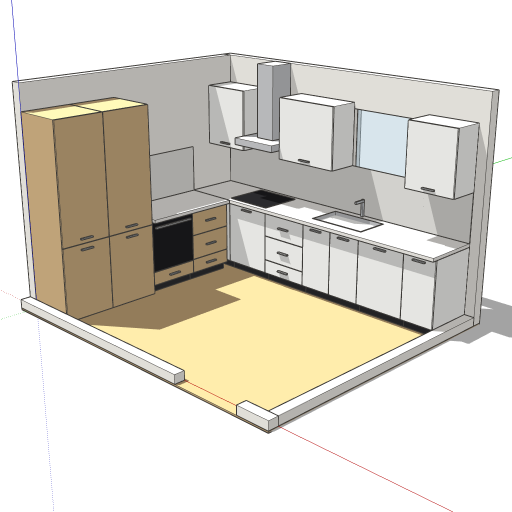
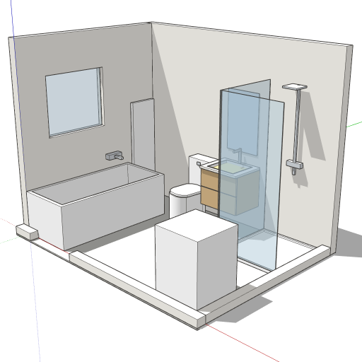

# Exemples validés sur le connecteur

Les deux scénarios ci-dessous ont été exécutés tels quels sur le connecteur (toolkit Python collé en
tête du `build_model`, `clean: true`), sans erreur, et sauvegardés ; les vignettes sont dans
`../assets/`. Leurs équivalents Ruby, prêts à charger dans SketchUp Desktop, sont
`../scripts/exemple_cuisine_L.rb` et `../scripts/exemple_salle_de_bain.rb` (validés avec
`../scripts/smoke_test.rb`).

## Cuisine en L, 360 × 300 × 250 — fenêtre au fond, porte sur le mur avant



```python
W, D, H = 360, 300, 250
room(model, W, D, H, full=("back", "left"),
     openings={"back": [("window", 200, 300, 110, 210)], "front": [("door", 250, 333, 1, 210)]},
     sol="sol_parquet")
runA, endA = kitchen_run(model, "Ligne_Fond", on_wall("back", 0, W, D),
    [("door", 60), ("hob", 60), ("drawers", 60), ("sink", 80), ("dishwasher", 60), ("door", 40)],
    hauts=[("door", 60), ("hood", 60), ("door", 80), ("open", 100), ("door", 60)], H=H)
runB, endB = kitchen_run(model, "Ligne_Gauche", on_wall("left", 0, W, D),
    [("fridge", 60), ("tall", 60), ("oven", 60), ("drawers", 55)], facade="facade_chene", H=H)
style_interieur(True)
cam = camera_maquette(bb_room(W, D, H), azimut=45)
result = {"endA": endA, "endB": endB, "cam": cam}
```

Ce que montre le snapshot : `Ligne_Fond` occupe x 0→141.7 in (360 cm), y 92.5→118.1 in (235→300 cm,
soit 65 cm de profondeur contre le mur du fond) ; `Ligne_Gauche` occupe x 0→25.6 in, y 0→92.5 in
(235 cm, elle s'arrête à 65 cm de l'angle) ; `Mur_back` a 10 faces (fenêtre), le muret avant est
coupé en deux au droit de la porte (250→333 cm).

Nomenclature livrée à l'utilisateur :

| Mur   | Position (cm) | Module             | Largeur |
| ----- | ------------- | ------------------ | ------- |
| fond  | 0–60          | meuble porte       | 60      |
| fond  | 60–120        | plaque + hotte     | 60      |
| fond  | 120–180       | tiroirs            | 60      |
| fond  | 180–260       | évier 1,5 cuve     | 80      |
| fond  | 260–320       | lave-vaisselle     | 60      |
| fond  | 320–360       | meuble porte       | 40      |
| gauche| 0–60          | colonne frigo      | 60      |
| gauche| 60–120        | colonne rangement  | 60      |
| gauche| 120–180       | four + tiroir      | 60      |
| gauche| 180–235       | tiroirs            | 55      |

## Salle de bain, 300 × 220 × 250 — baignoire, WC, meuble vasque, douche, lave-linge



```python
W, D, H = 300, 220, 250
room(model, W, D, H, full=("back", "left"),
     openings={"left": [("window", 40, 130, 120, 200)], "front": [("door", 20, 103, 1, 210)]},
     sol="sol_carrelage")
bathtub(model, "Baignoire", on_wall("left", 0, W, D))
toilet(model, "WC", on_wall("back", 90, W, D))
vanity(model, "Meuble_Vasque", on_wall("back", 140, W, D), w=60)
shower(model, "Douche", on_wall("back", 210, W, D), W=90, D=90, paroi="left")
radiator(model, "Seche_Serviettes", on_wall("left", 175, W, D), w=40)
washer(model, "Lave_Linge", on_wall("front", 0, W, D))
style_interieur(True)
cam = camera_maquette(bb_room(W, D, H), azimut=45)
result = {"cam": cam}
```

Dégagements obtenus : 60 cm devant le WC (axe à 110 cm du mur gauche, à 35 cm de la baignoire et
à 30 cm du meuble vasque) ; 70 cm devant la vasque ; douche en angle avec sa paroi côté vasque ;
lave-linge dans l'angle avant-droit, hors du balayage de la porte (20→103 cm sur le mur avant).

## Variantes rapides

- Cuisine linéaire + îlot (pièce 450 × 400) : une seule `kitchen_run` sur `back`, puis
  `island(model, "Ilot", (120, 400 - 65 - 110, 0), L=200, P=100, hob=True)` : l'îlot est à 110 cm
  du plan du fond (`pos` = coin arrière-gauche, il s'étend vers −Y).
- Cuisine en U : `full=("back", "left", "right")`, trois `kitchen_run`, la ligne du fond possède les
  deux angles, les lignes latérales s'arrêtent à `D - 65` ; caméra `azimut=90`.
- Plan de travail à 92 cm : `K = {**KIT, "caisson_h": 78}` puis `kitchen_run(..., K=K)`.
- Double vasque : `vanity(..., w=120)` puis deux `tap(A, 30, 3, 85)` / `tap(A, 90, 3, 85)` dans le
  groupe retourné (le toolkit ne centre qu'un mitigeur) ; ou deux `vanity` de 60 côte à côte.
- WC suspendu : `assembly` + `box` bâti 40 × 20 × 115 (matériau `mur`) + `rounded` cuvette 36 × 52
  × 35 posée à z = 10 (`yw = 20`).
